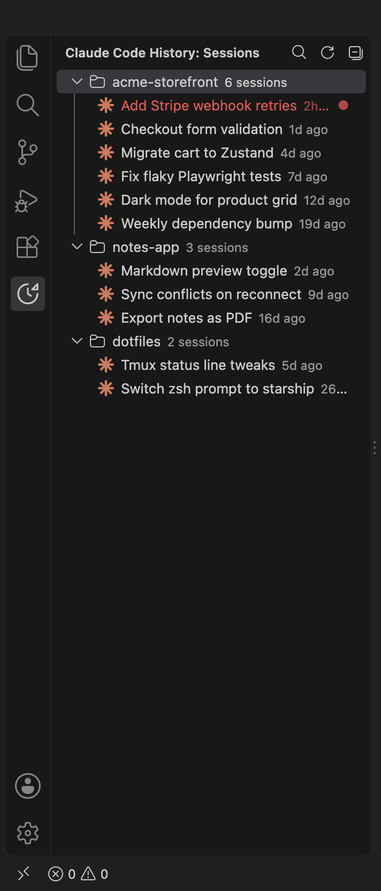
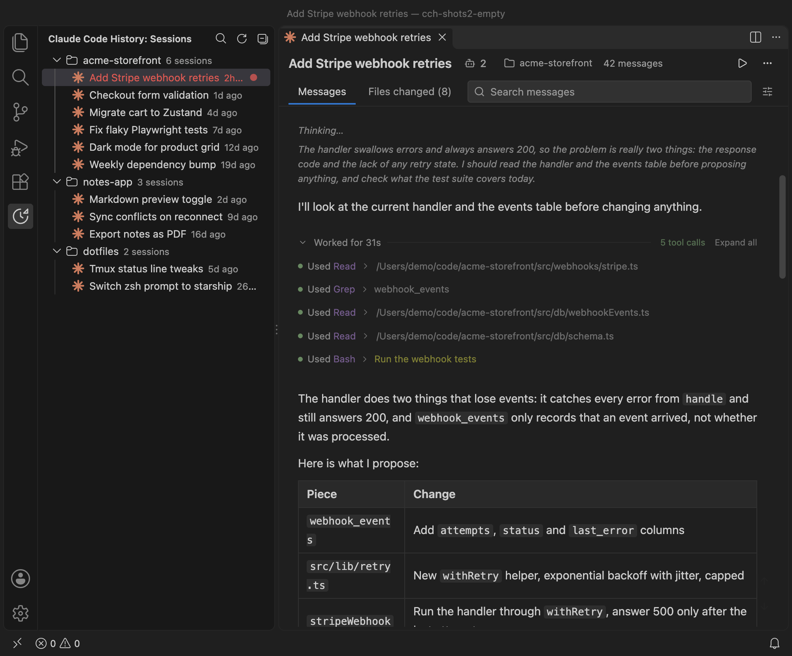
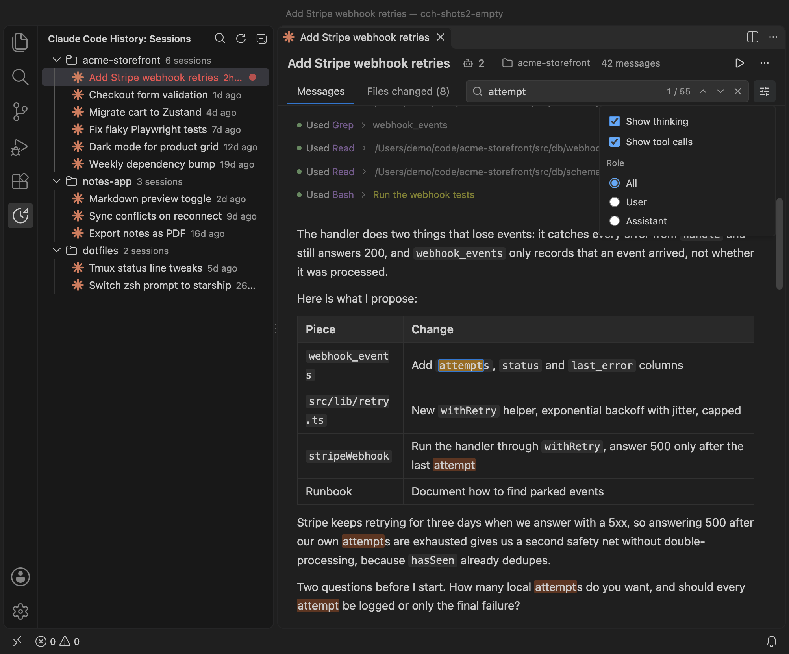
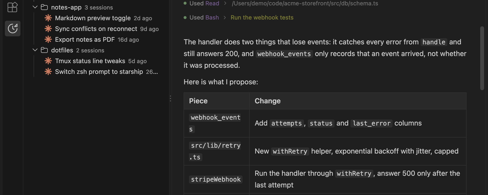
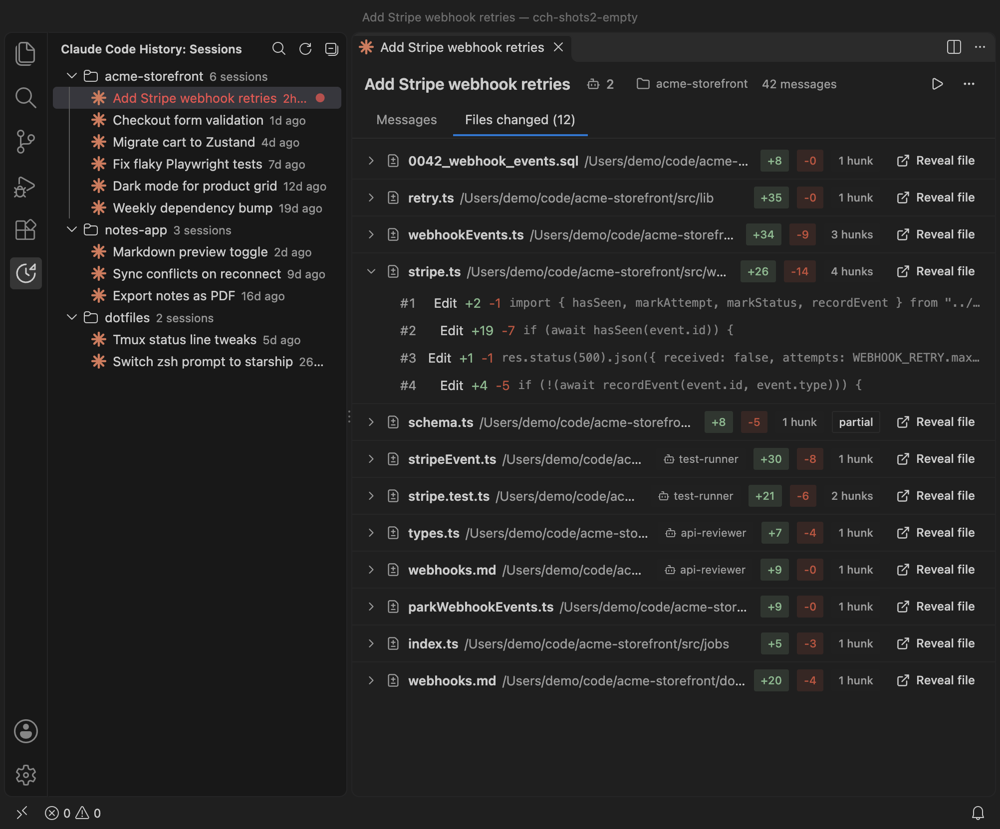
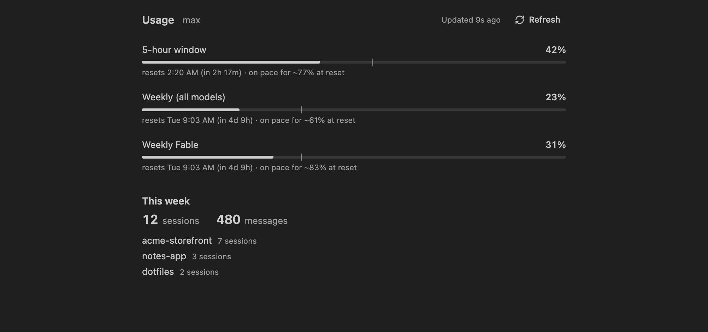
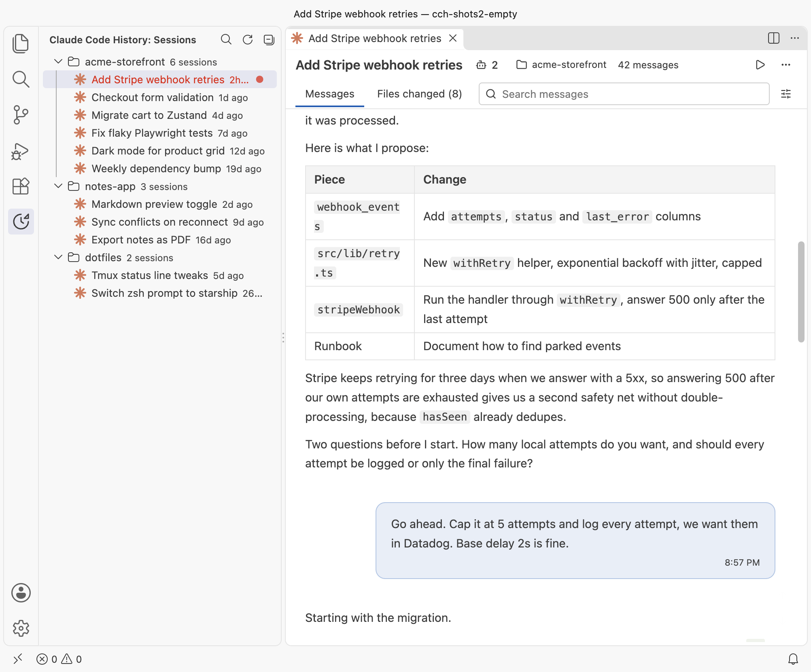

# Claude Code History

A read-only VS Code viewer for your Claude Code session logs. Every session, every project, no seven-day window. A status bar widget shows how much of your Claude Code rate limit is used.


[Watch the tour as an mp4](https://github.com/anindosarker/cc-history-extension/releases/download/v0.4.1/intro.mp4).

## Screenshots



The Sessions view: every project, every session, newest first, with running, open and recently ended dots.



The session viewer: virtualized messages, markdown, collapsible thinking and tool calls, clickable file paths.



Search inside a session with a match counter, next and previous, and role, thinking and tool filters.



Subagent transcripts: an Agents popover, per-agent views and links from Agent tool calls.



Files changed in a session, with whole-file and per-hunk diffs in the native diff editor.



The usage panel: 5-hour, weekly and per-model limits with pace markers, projections and this week's sessions.



Everything follows your theme, light or dark.

## What it does

- Lists all sessions under `~/.claude/projects`, grouped by project and sorted by recent activity.
- Opens a session in an editor tab with virtualized messages, markdown rendering, collapsible thinking blocks and tool calls.
- Searches inside a session (case-insensitive, with match count, next and previous navigation, and highlighting) and filters by role, thinking, and tool calls.
- Shows subagent transcripts, with an Agents popover and links from Agent tool calls.
- Shows the files a session changed, with whole-file and per-hunk diffs in the native VS Code diff editor.
- Exports a transcript as plain text to a file or to the clipboard.
- Resumes a session with `claude --resume <id>` in an integrated terminal.
- Shows Claude Code usage limits in the status bar and in a usage panel.

It never writes to your session logs and has no chat features.

## Install from the Marketplace

Search for "Claude Code History" in the Extensions view, or open the listing:

https://marketplace.visualstudio.com/items?itemName=anindosarker.cc-history

For VSCodium and other builds that use Open VSX, search for "Claude Code History" in the Extensions view, or open the Open VSX listing at https://open-vsx.org/extension/anindosarker/cc-history.

## Install from the .vsix

```sh
code --install-extension cc-history-0.4.0.vsix
```

Or in VS Code: Extensions view, the `...` menu, "Install from VSIX...".

## Usage

- Click the asterisk icon in the activity bar to open the Sessions view.
- Click a session to open it. Right-click for Resume, Export, Copy Session ID and Reveal JSONL.
- Use the search icon in the view title (or the "Claude Code History: Find Session" command) to search across all sessions.
- Inside a session, press Cmd+F (Ctrl+F on Windows and Linux) to focus the message search. Enter goes to the next match, Shift+Enter to the previous one, Escape clears.
- Click the usage widget in the status bar to open the usage panel. "Claude Code History: Show Usage Log" opens the output channel with every poll outcome.

### Move the view

The view lives in a container, so you can drag the "Claude Code History" icon from the activity bar into the secondary sidebar or the bottom panel. Drag it back to the activity bar to undo.

## Privacy

Everything stays on your machine. The extension reads your Claude Code session logs from disk and never writes to them. There is no telemetry, no analytics and no account.

The only network request the extension ever makes is a GET to `api.anthropic.com/api/oauth/usage`, and only while the usage widget is on. Nothing from that request is stored: the reply is kept in memory for the status bar and the usage panel, and the credential it uses is never written to disk, VS Code storage or the output log. Set `ccHistory.usage.enabled` to `false` and no request is made at all.

## Settings

### Sessions view

| Setting | Default | Description |
| --- | --- | --- |
| `ccHistory.projectsDir` | `~/.claude/projects` | Folder containing Claude Code project logs. |
| `ccHistory.sessionsDir` | empty | Folder with live session files for the status dots. Empty uses the sessions folder next to the projects folder. |
| `ccHistory.tree.showStatus` | `true` | Show the running, open and recently ended dots. When off, the sessions folder is not watched or polled. |
| `ccHistory.tree.hideProjects` | `["/private/var/folders/**", "/tmp/**"]` | Glob patterns for project folders to hide from the Sessions view, Find Session and the usage panel's week summary. |
| `ccHistory.claudeCommand` | `claude` | Command used when resuming a session. |
| `ccHistory.openAt` | `oldest` | Open a session at the first or the latest message. |
| `ccHistory.export.includeToolResults` | `false` | Include tool results in text exports. |
| `ccHistory.export.includeThinking` | `false` | Include thinking blocks in text exports. |

### Usage widget

| Setting | Default | Description |
| --- | --- | --- |
| `ccHistory.usage.enabled` | `true` | Poll Claude Code usage with the credentials Claude Code stores locally. |
| `ccHistory.usage.intervalSeconds` | `60` | Seconds between polls while the window is focused. |
| `ccHistory.usage.showInStatusBar` | `true` | Show the widget in the status bar. |
| `ccHistory.usage.warnAt` | `75` | Percent at which the widget turns to the warning colour. |
| `ccHistory.usage.errorAt` | `90` | Percent at which the widget turns to the error colour. |
| `ccHistory.usage.colorMode` | `background` | `background` tints the whole item, `text` colours only the text, `off` never colours it. |
| `ccHistory.usage.colorBy` | `max` | `max` uses the highest shown limit, `fiveHour` only the 5-hour window. |
| `ccHistory.usage.format` | `full` | `full` shows every limit with a label, `compact` bare numbers, `max` only the highest limit. |
| `ccHistory.usage.pulse` | `true` | At the error level, swap the sparkle icon for a pulse and mark the limit that crossed the threshold. |

The "Claude Code History: Show Usage Log" command opens an output channel that records every poll outcome, never a token or a header value.

## Usage widget and your credentials

The status bar usage widget shows how much of your Claude Code rate limit is used. To do that it reads the Claude Code OAuth token, from the macOS Keychain entry "Claude Code-credentials" or, elsewhere, from `~/.claude/.credentials.json`. The token is used for one request only: a GET to `api.anthropic.com/api/oauth/usage`, the same endpoint Claude Code itself calls. It is kept in memory until shortly before it expires, never written to disk or VS Code storage, never logged, and never sent anywhere else.

On macOS the first read may show a Keychain access prompt for the `security` tool. Choosing "Always Allow" ends the prompts. The first time the extension activates it shows a one-time notice about this, with a button that turns the widget off. Setting `ccHistory.usage.enabled` to `false` turns the whole widget off, and nothing is read.

## Development

Requires Node 20+ and pnpm 10.

```sh
pnpm install
pnpm build        # host (esbuild) and webview (vite)
pnpm typecheck
pnpm lint
pnpm test         # vitest unit tests
pnpm smoke        # index your real ~/.claude/projects and print timings
pnpm package      # builds and writes cc-history-0.4.0.vsix
```

Press F5 in VS Code to launch an Extension Development Host with the "Run Extension" configuration. The `watch` task rebuilds the host and webview on change.

The Marketplace icon is generated by `scripts/make-icon.mjs` from `media/session-claude.svg`; see the header of that script for how to run it.

### Layout

```
src/extension   extension host: indexer, streaming parser, tree, webview panel, diffs, export, resume, usage
src/shared      types and the host to webview message protocol
src/webview     React UI (Vite, Tailwind v4, vendored shadcn components)
media           icons and screenshots
tests           vitest unit tests with synthetic fixtures
scripts         smoke test against real data, icon generator
```

## License

MIT
